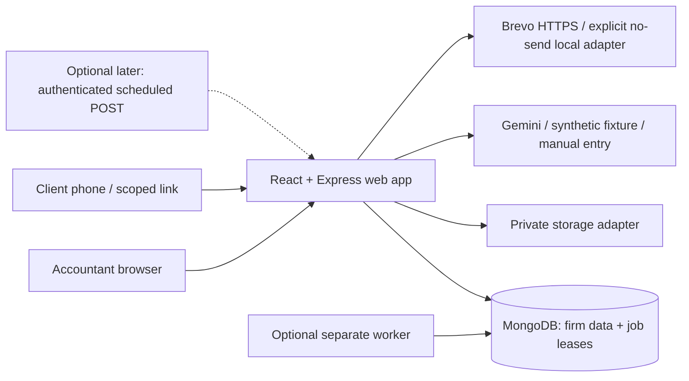
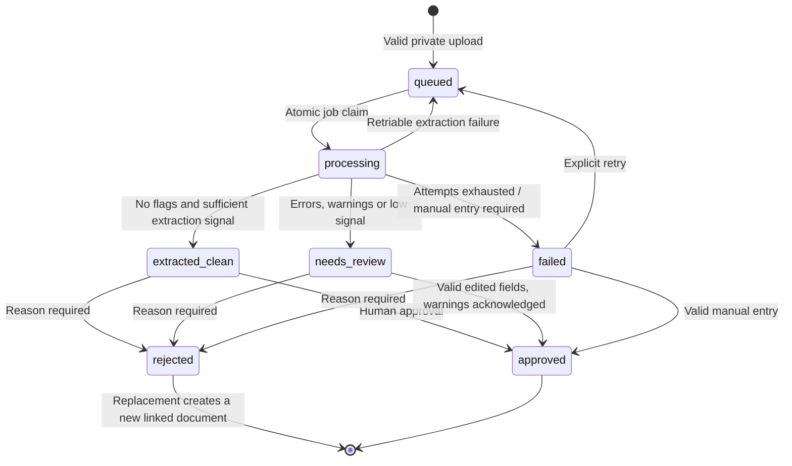
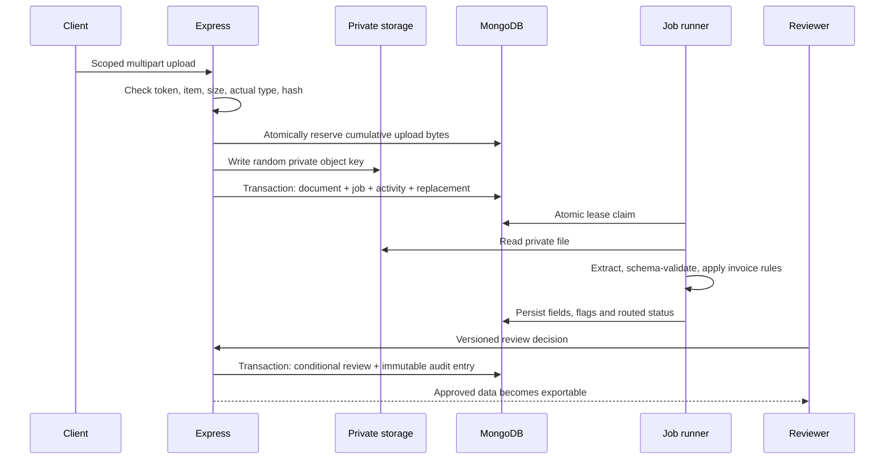

# Architecture

Authentication and firm scope apply to every private route. Magic links authorize exactly one checklist and expose only client-facing document status. Original files require firm authentication; public storage URLs are not returned.

## Modules and scale
- `auth.js`: session cookies, token revocation, roles and CSRF origin/header checks.
- `routes.js`: firm workflows. IDs are always queried together with the session firm ID.
- `portal.js`: token scope, file admission and transactional upload/replacement handling.
- `domain.js`: pure validation, lifecycle, completion, reminder schedule and safe CSV serialization.
- `jobs.js`: persisted job leases, retry timing, quota reservations and recovery.
- `storage.js`, `extractor.js`, `reminders.js`: provider boundaries.

The current queue processes one document at a time per process to fit small free instances. Atomic claims support splitting the worker later without introducing Redis. Mongo transactions require a replica set; local development uses a one-member replica set. Indexes support tenant-filtered queries, duplicate hashes, invoice lookup, token hashes and reminder uniqueness.

Before large firms, add cursor pagination, projection/aggregation-based summaries, streaming file downloads and per-firm storage quotas. Apply these changes at existing module boundaries. No microservice rewrite is necessary for the coursework scale.

## Submission resource profile
The default per-file cap is 5 MB. A MongoDB infrastructure record, `UploadAllowance/application`, atomically reserves upload bytes against a cumulative 100 MB allowance shared across this deployment. Initialization includes existing document sizes; seed files use the same guard. Deletion and storage failures do not refund bytes, so repeated upload/delete cycles cannot bypass the cap. This is deliberately conservative prototype admission control, not a billing or storage-accounting system. It does not meter egress or unrelated files in the provider account.

The browsers do not poll. Local actions invalidate affected queries, returning to a stale tab can refetch, and explicit Refresh controls load another person's changes. The internal job timer runs only inside the existing web process and makes no public keep-alive request. A sleeping host stops that process; pending jobs resume on wake. The submission profile uses no external cron job, no live AI key, and no real email provider. Scheduled delivery during host sleep is outside this prototype's guarantees.

## Reliability semantics
Uploads compensate for failed database transactions by deleting the newly written file. Reviews and audit entries share a transaction. A stale review version returns 409. Checklist completion is derived from all current item documents: client notes are not waivers; multiple-file items also need explicit client completion.

Jobs have unique keys, atomic leases, three attempts, 30-second / 2-minute retry delays and ten-minute stale lease recovery. Manual mode immediately surfaces a human-entry path. A missing provider never fabricates extracted data.

Reminder slots are unique per checklist and channel. Creating a `sending` record claims a slot before contacting the provider. Unconfirmed delivery is marked uncertain, and a crashed send is not blindly retried; exactly-once external delivery is not claimed. Completing or pausing a request stops eligible future reminders. Scheduling uses IST dates and 21:00–08:00 quiet hours.

Validation uses integer paise for reconciliation (₹1 tolerance). Tax-treatment and unusual-rate checks are warnings for human review, accommodating exceptions. Confidence signal = 0.6 × minimum valid field score + 0.4 × mean valid field score, rounded to four decimals. It is not a calibrated accuracy measure.
